# CycleGen — Brief application + refonte studios (pour agents LLM)

> Document **autonome** destiné à un agent (Gemini, Cursor, etc.) qui doit comprendre
> l’état actuel de CycleGen **et** la refonte UX/API prévue, sans lire tout le dépôt.
>
> Dernière mise à jour : 2026-10-01 (révision **challenge Gemini** intégrée)  
> Plan Cursor : `.cursor/plans/refonte_ux_cyclegen_*.plan.md`  
> Règles agent : [`.cursor/rules/refonte-cyclegen.mdc`](../.cursor/rules/refonte-cyclegen.mdc) · [`docs/refonte-master-rules.md`](refonte-master-rules.md)  
> Artefacts RS : `backend/app/data/benchmark/calibration/route_studio_here/`

---

## 0. En une phrase

**CycleGen** génère des **cycles de conduite synthétiques** (profils v(t), a, pente, GPS…)
à partir d’un **trajet** (adresses / GPS → corridor spatial → IDM) ou d’une **trace importée**,
avec bibliothèques locales (conducteurs, véhicules, cycles) et comparaison multi-cycles
(Versus). Un pipeline offline **Route Studio (AVL)** fingerprint / geometry-lock / HTML
existe en scripts Python ; la refonte doit le **porter dans l’API** et le **réorganiser en studios métier** sans régression.

---

## 1. Stack et layout dépôt

| Couche | Techno | Racine |
|--------|--------|--------|
| Frontend | Next.js App Router, TypeScript, React, Tailwind (charte CycleGen slate/brand — **pas** MarketChain) | `frontend/` |
| Backend | FastAPI, Python 3, IDMSolver, OSRM/HERE, SUMO optionnel | `backend/app/` |
| Scripts batch / calibration | Python (xlrd, openpyxl, xlwt) | `scripts/` |
| Docs science / aide | Markdown | `docs/`, `frontend/public/docs/` |
| Données seed / fit pack | JSON static servi par Next | `frontend/public/data/` |

**Lancer (typique)**  
- API : `cd backend && .venv/bin/uvicorn app.main:app --reload`  
- UI : `cd frontend && npm run dev` → `http://localhost:3000`  
- CORS : `CORS_ORIGINS` dans `.env` ; clé optionnelle `CYCLEGEN_API_KEY`

---

## 2. Domaine métier (vocabulaire)

| Terme | Signification |
|-------|----------------|
| **Trajet** | A→B (adresses ou lat/lon) → géométrie + trafic + pente |
| **Corridor** | Discrétisation spatiale `S`, `V_legal`, `V_curve`, `V_envelope`, `alpha`, géométrie |
| **Conducteur** | Profil comportemental IDM : `a_max`, `b_comf`, `speed_factor`, jerk, `T`, `s0`… + **lag pédale** (`pedal_tau_s`, `vdes_tau_s`, `descent_hold_gain`) |
| **Véhicule** | Masse, code TM, F0/F1/F2, `r_dyn` → puissance / couple post-process |
| **Cycle** | Série temporelle / spatiale générée ou importée (v, a, s, pente, GPS…) |
| **Route Studio (RS)** | Exports AVL XSPACE `.xls` (prudent / dynamique) servant de **référence** |
| **PreA** | Profil officiel Grossglockner (xlsx, pas de GPS) → 3ᵉ conducteur + référence v |
| **Geometry-lock** | Rejeu IDM sur la **géométrie RS** (synth_corridor), pas un nouveau routage HERE |
| **Fingerprint** | Stats d’un roulage (a P85, b P95, sf, a_lat, osc…) → overrides IDM |
| **Versus** | Overlay multi-cycles dans l’UI (`/compare`) |
| **Fidélité** | Score composite RMSE_v + ΔT + osc (pipeline RS) |

**Profils enum API** (`DriverProfile`) : `Eco`, `Normal`, `Agressif`, `Sportif`, `Prudent`, `Dynamique`.  
**PreA n’est pas un enum** : c’est `Dynamique` + overrides (ou id `xspace-prea-grossglockner` en lib frontend).

---

## 3. Application actuelle (AS-IS)

### 3.1 Routes UI

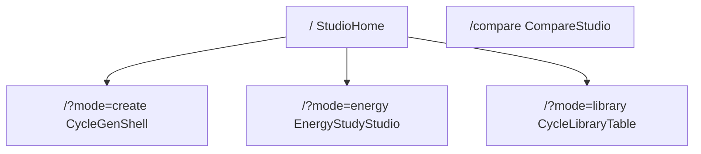

Header actuel (`AppHeader`) : Accueil · Créer · Bibliothèque · Versus.

### 3.2 Wizard GPS (`/?mode=create`) — 4 steps

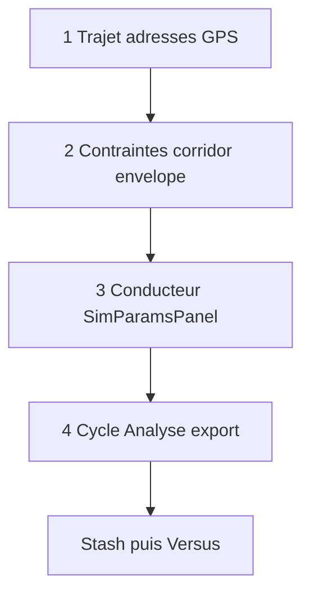

| Step | UI principale | API |
|------|---------------|-----|
| 1 Trajet | Sidebar + map | `POST /api/route/analyze` |
| 2 Contraintes | `ConstraintWorkspace` | `POST /api/corridor/build` |
| 3 Conducteur | `SimParamsPanel` (+ identify XLS client) | params dans `simulate/start` |
| 4 Cycle | `ResultsAnalysisPanel` / playback | `POST /api/simulate/start` + WS |

Orchestrateur monolithique : `frontend/src/components/CycleGenShell.tsx` (~3.5k lignes).  
Session : `frontend/src/lib/studioSession.ts` (survit Accueil ↔ Versus).

### 3.3 Porte « Trace » (`/?mode=energy`)

Import t, v, pente (sans GPS obligatoire) → véhicule → P/couple → même analyse.  
Composant : `EnergyStudyStudio.tsx`.

### 3.4 Bibliothèques (navigateur / localStorage)

| Banque | Module | Clé / pack |
|--------|--------|------------|
| Cycles | `cycleLibrary.ts` | + seed `xspace_avl_seed_cycles.json`, `route_studio_fit_pack.json` |
| Conducteurs | `driverLibrary.ts` | presets + upsert pack |
| Véhicules | `vehicleLibrary.ts` | masse F0/F1/F2 |
| Trips | `tripStore.ts` | snapshots trajet |

**Identify conducteur (client)** : `driverIdentify.ts` + upload dans `SimParamsPanel` (pas d’API serveur).

**Pack Route Studio** : `ensureRouteStudioFitPack()` fetch `/data/route_studio_fit_pack.json` (cycles `rs_fit_*` + 3 drivers).  
Fichier jumeau `route_studio_drivers.json` : **écrit par scripts, non fetché** par l’UI.

### 3.5 Versus (`/compare`)

Overlay multi-séries (v, a_lon, a_lat, pente…) — **pas** de vue « score de fit » RS.  
`BenchmarkViewer` / `VariantComparePanel` existent mais **non branchés** dans la nav.

### 3.6 API FastAPI (AS-IS)

Préfixe `/api` (sauf `/health`) :

| Router | Endpoints utiles |
|--------|------------------|
| route | `geocode`, `elevation`, `route/analyze` |
| corridor | `corridor/build` |
| simulate | `simulate/start`, WS, `stop` |
| scenario | `scenario/run` (multi-bras IDM) |
| export | `export` **csv \| xml** seulement |
| benchmark | `sources`, `sources/{id}`, `run` |
| calibrate | `calibrate/n90` (grille vs AVL N90) |

**Trou schema** : `DriverParamOverrides` n’expose **pas** encore `pedal_tau_s` / `vdes_tau_s` / `descent_hold_gain` (le solver les accepte en interne).

### 3.7 Moteur cinématique

`backend/app/services/kinematic_solver.py` :
- IDM + grade + preview brake + envelope
- Profils Prudent / Dynamique seedés RS
- **Lag pédale** déjà dans le solver (`pedal_tau_s`, `vdes_tau_s`, `descent_hold_gain`)

### 3.8 Pipeline Route Studio (OFFLINE — scripts)

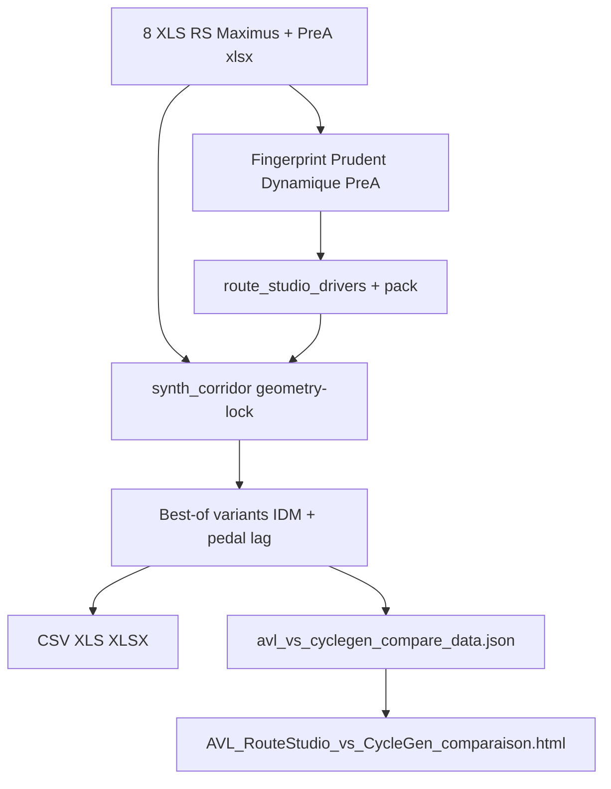

Scripts clés :
- `scripts/batch_xspace_avl_compare.py` — `load_xls`, `fingerprint`, `synth_corridor`, `score_vs_avl`
- `scripts/batch_route_studio_here_replay.py` — HERE A/B, export xls, identify drivers
- `scripts/_refit_route_studio_pedal.py` — refit 8 RS + PreA (pedal lag, sf floors)
- Sortie : `backend/app/data/benchmark/calibration/route_studio_here/`

**État calibration typique (oct 2026)** : 9 paires ; 3 conducteurs ; Glock PreA RMSE ~8–9 km/h ; Iseran prudent parmi les meilleurs ; HTML Plotly sync X.

Ce pipeline **n’est pas** exposé en endpoints FastAPI aujourd’hui.

---

## 4. Refonte cible (TO-BE) — principes (spécification produit finale)

**Paradigme :** IDE d’ingénierie (AVL / Simulink), **pas** SaaS à hubs / `/?mode=` métiers.

1. **Workspace unifié** — Explorateur | Canvas carte+courbes sync | Inspecteur | Console. Hub = onboarding seulement.
2. **Inspecteurs** pour Conducteur/Véhicule ; **drawers/modales** pour batch RS / ingestion lourde.
3. **Cheap vs Expensive** — *Update dynamics* (IDM debounced 50–100 ms) vs *Rebuild corridor* (action explicite) vs fit **async jobs**.
4. **Zustand** — `hoverIndex`/`playhead` + ledger 3 strates ; pas de corridor via URL.
5. **Zéro régression** — Shell `/?mode=create`, e2e, simulate, pack/batch RS, exports, Versus.
6. **Banques async** (Dexie) + SHA-256 fingerprint ; pedal defaults 0.
7. **UI austère** — mono scalaires, couleur sémantique, zéro bullshit UI.

Charte : CycleGen slate/brand — **pas** MarketChain.  
Règles agent : [`docs/refonte-master-rules.md`](refonte-master-rules.md) · `.cursor/rules/refonte-cyclegen.mdc`.

---

## 4bis. Challenge Gemini — vulnérabilités et décisions adoptées

Revue externe (Gemini) : le brief studios est clair, mais 3 risques système majeurs. **Décisions figées ci-dessous** (plus d’options ouvertes).

### A. État frontend / cycle de vie

**Risque** : éclater `CycleGenShell` (~3500 lignes) en studios isolés + `studioSession.ts` → stale data, course conditions, corridor désynchronisé.

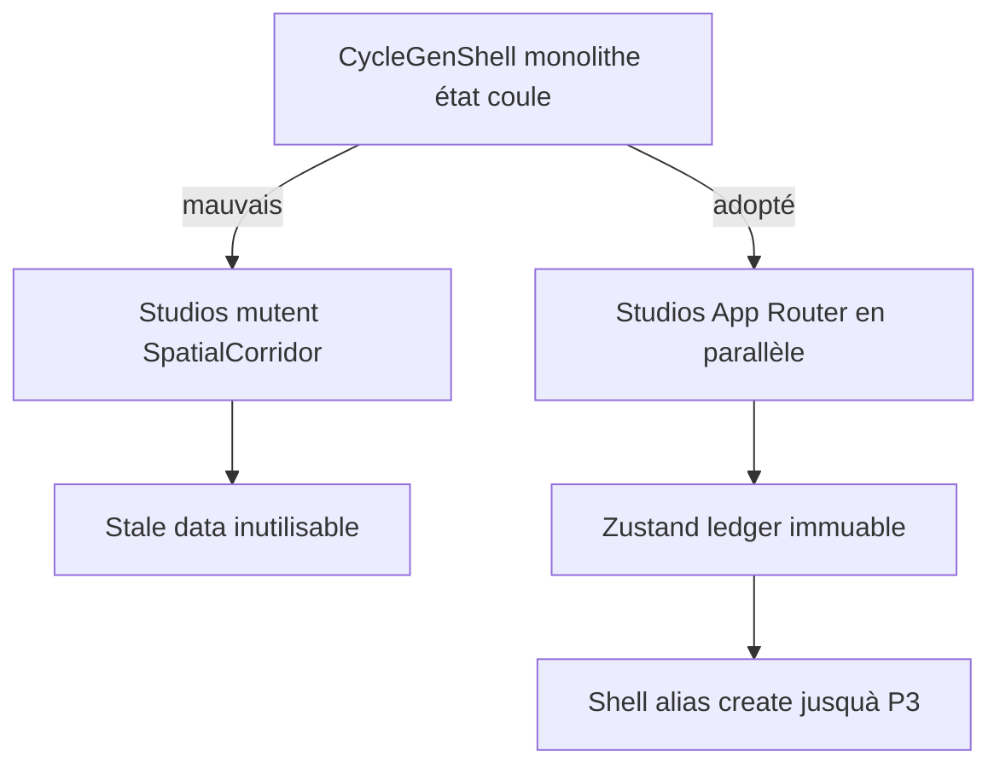

**Décisions adoptées**
- **Ne pas** refactoriser `CycleGenShell.tsx` en une passe.
- Construire les studios sous App Router (ex. `frontend/src/app/(studios)/driver/…`) **en parallèle** ; l’ancien shell reste monté sur `/?mode=create` jusqu’à **fin de P3 validée**.
- Remplacer progressivement `studioSession.ts` par un **store Zustand typé** à 3 strates strictes :
  1. **Config** — conducteur, véhicule, lois de route (IDs + params)
  2. **Géométrie déterministe** — corridor / envelope (référence immuable côté client ; pas de mutation in-place)
  3. **Résultats d’exécution** — séries temporelles simu / fit (remplaçables)
- **Interdit** : passer de gros objets JSON (corridor, traces) via l’URL.
- Types frontend **alignés** sur schémas Pydantic (génération ou miroir strict). **Aucune** logique métier lourde (interpolation, smoothing grade, Markov) dans les composants UI — backend only.

### B. Goulot calibration / fit

**Risque** : `POST /api/calibrate/route-studio/fit` synchrone = timeouts + blocage event-loop FastAPI.

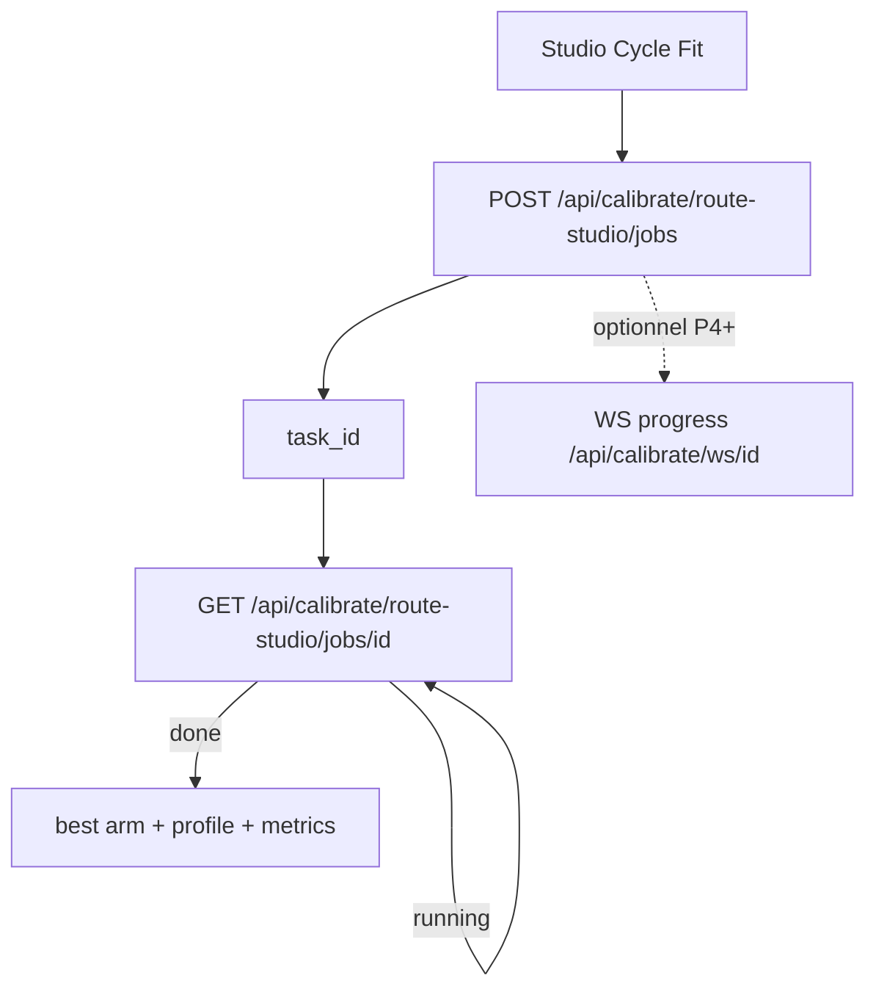

**Décisions adoptées**
- **Interdiction** d’un fit REST synchrone bloquant.
- Modèle **soumission + Task ID + polling** (paradigm proche simulate ; WS progress optionnel ensuite).
- Services `rs_fingerprint.py`, `rs_geometry_fit.py`, `rs_compare.py` = **fonctions pures / déterministes**, sans I/O router ; DI explicite des params physiques / pedal lag.
- `pedal_tau_s`, `vdes_tau_s`, `descent_hold_gain` dans Pydantic : **default 0** (rétrocompat cycles sauvés).

### C. Persistance banques locales

**Risque** : CRUD studios sur localStorage brut → fragile, non testable, casse aux migrations de schéma ; gros GPS bloquent l’UI.

**Décisions adoptées**
- Encapsuler `driverLibrary` / `vehicleLibrary` / `cycleLibrary` derrière des **interfaces async** (impl initiale : wrapper ; cible : **IndexedDB via Dexie**).
- Lectures traces lourdes : async, jamais bloquer le render.
- Fingerprint : attacher un **SHA-256** du fichier source (CSV/XLS) aux métadonnées conducteur (traçabilité scientifique).

### D. Méthode LLM

- Une **phase à la fois** (P0→P5) ; hors-périmètre = interdit.
- Une source de vérité scientifique : solver + `rs_*` — pas de double implémentation UI.
- Pas d’interpolation / smoothing « cosmétique » dans React.

---

## 5. Information architecture cible

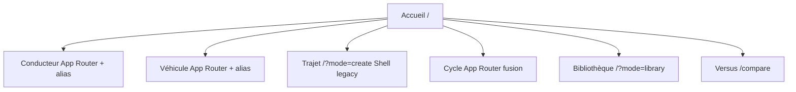

### Header cible

Accueil · Conducteur · Véhicule · Trajet · Cycle · Bibliothèque · Versus

### Routes App Router (nouveaux) vs aliases

| Studio | Route cible (créer) | Alias compat (garder) |
|--------|---------------------|------------------------|
| Conducteur | `/driver` ou `/(studios)/driver` | `/?mode=driver` |
| Véhicule | `/vehicle` | `/?mode=vehicle` |
| Trajet | (plus tard) `/trajet` | `/?mode=create` → **CycleGenShell** jusqu’à P3 |
| Cycle | `/cycle` | `/?mode=cycle`, `/?mode=energy` → redirect |
| Bibliothèque | — | `/?mode=library` |
| Versus | — | `/compare` |

### Parcours nominal

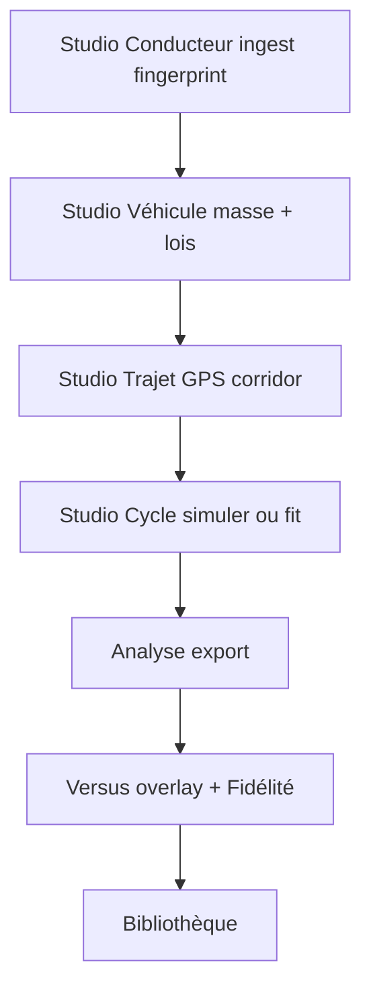

---

## 6. Détail de chaque studio (TO-BE)

### 6.1 Studio Conducteur — `/?mode=driver` (**nouveau**)

**Job utilisateur** : créer / éditer un conducteur à partir de roulages réels.

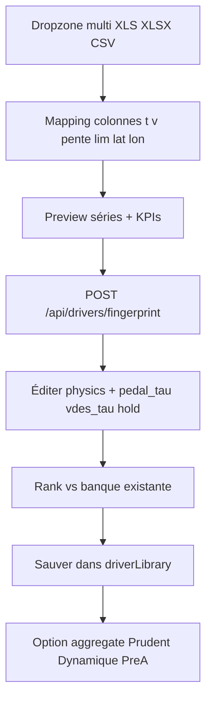

**Recycle**  
`driverIdentify.ts`, `driverLibrary.ts`, `driverPresets.ts`, `parseCycleFile.ts`, logique UI identify de `SimParamsPanel.tsx`.

**Crée**  
`DriverStudio.tsx`, batch multi-fichiers, champs lag pédale visibles, clients API fingerprint/aggregate, tags (RS / PreA / custom).

**Critères done**  
- 1 fichier → conducteur sauvé utilisable dans Cycle  
- N fichiers RS → 2 ou 3 presets agrégés  
- Params pedal transmis à `simulate` / fit

---

### 6.2 Studio Véhicule — `/?mode=vehicle` (**promu**)

**Job** : banque véhicules + **lois de route** nommées (filtres V_legal, caps, presets région).

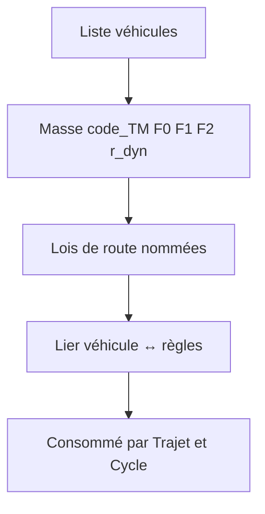

**Recycle**  
`vehicleLibrary.ts`, `VehiclePanel.tsx`, `vehiclePower.ts`, `legalFilter.ts`.

**Crée**  
`VehicleStudio.tsx` pleine page, CRUD lois, binding véhicule↔règles, entrée header.

**Critères done**  
- Créer véhicule + loi « Alpine AT » et l’appliquer sur un Trajet  
- Energy / Cycle utilisent le même picker

---

### 6.3 Studio Trajet — `/?mode=create` (**extraction**)

**Job** : adresses / GPS → analyze → corridor → contraintes (ancien steps 1–2).

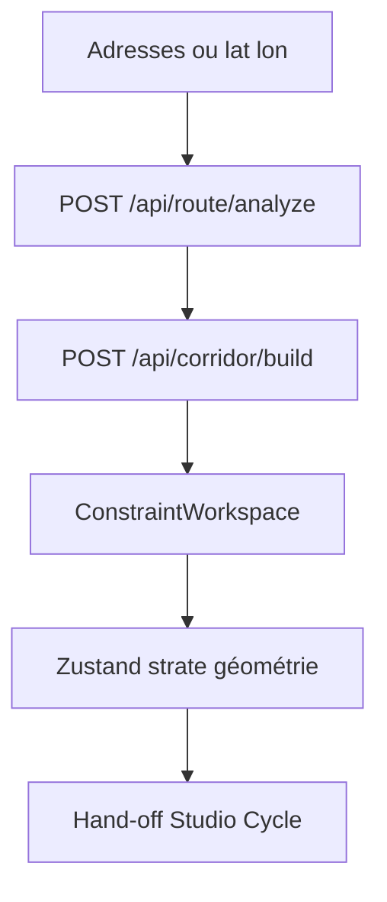

**Recycle**  
Cœur `CycleGenShell` steps 1–2, Sidebar trajet/contraintes, map, APIs.

**Crée**  
Shell `TrajetStudio` allégé ; step « Conducteur » du vieux wizard devient **picker** vers la banque (plus d’édition identify lourde ici).

**Alias** : `/?mode=create` reste l’URL canonique Trajet (compat e2e).

---

### 6.4 Studio Cycle — `/?mode=cycle` (**fusion**)

**Job** : prendre un corridor **ou** une trace → Conducteur + Véhicule → simuler **ou** geometry-lock fit → Analyse → export.

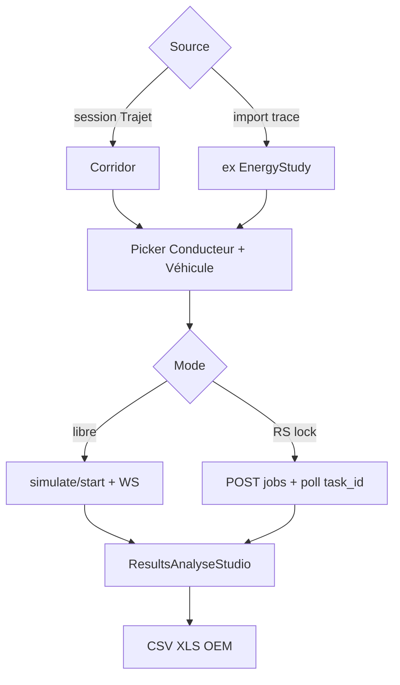

**Recycle**  
`ResultsAnalysisPanel`, `ResultsAnalyseStudio`, playback, `DownloadButtons`, `exportWorkbook`, `exportBench`, `EnergyStudyStudio` (fusionné), simulate/export.

**Crée**  
`CycleStudio.tsx`, panneau Fit **async** (soumission job + poll), scores RMSE/osc/fidélité, consommation `rs_fit_*`, mode unifié GPS/trace.

**Alias** : `/?mode=energy` → redirect ou même studio avec source=trace.

---

### 6.5 Versus — `/compare` (**enrichi**)

**Recycle** : `CompareStudio.tsx` overlay.

**Crée** : onglet / bandeau **Fidélité** (RMSE, score, osc, ΔT, ΔL) depuis API compare ou metadata pack ; lien HTML rapport optionnel.

---

### 6.6 Bibliothèque — `/?mode=library` (**stable + onglets**)

**Recycle** : `CycleLibraryTable`, `ensureRouteStudioFitPack`.

**Crée** : onglets Cycles / Conducteurs / Véhicules ; afficher `summary` du fit pack (aujourd’hui ignoré après merge).

---

## 7. API à créer / étendre (détail)

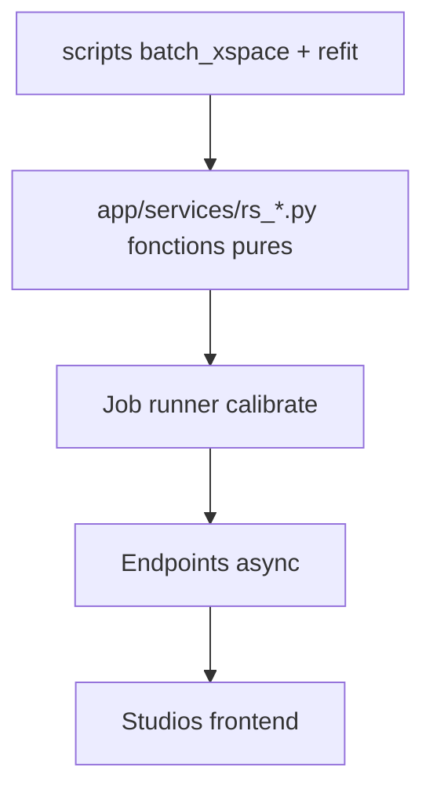

| Méthode | Path | Rôle | Contrainte |
|---------|------|------|------------|
| POST | `/api/drivers/fingerprint` | Upload → fingerprint + physics + **sha256 source** | CPU léger OK sync court |
| POST | `/api/drivers/aggregate` | Multi → Prudent/Dynamique/PreA | sync court |
| POST | `/api/calibrate/route-studio/jobs` | **Soumettre** fit geometry-lock | retourne `task_id` immédiat |
| GET | `/api/calibrate/route-studio/jobs/{id}` | Statut + résultat / erreur | polling |
| WS | `/api/calibrate/ws/{id}` | Progress optionnel | P4+ |
| POST | `/api/calibrate/route-studio/compare` | Alignement + fidélité | sync si léger, sinon job |
| GET | `/api/calibrate/route-studio/pack` | Pack summary | lecture |
| POST | `/api/export` | + **xlsx** multi-canaux | — |

**Interdit** : `POST …/fit` synchrone qui attend la fin du best-of variants.

**Schéma pedal** (defaults **0**) :

```text
pedal_tau_s: float = 0
vdes_tau_s: float = 0
descent_hold_gain: float = 0
```

Services : `rs_fingerprint.py`, `rs_geometry_fit.py`, `rs_compare.py` — pure logic ; routers = thin. Scripts CLI = wrappers.

---

## 8. Matrice Recycle vs Crée (check-list agent)

### Frontend — RECYCLE (ne pas réécrire)

- [ ] Wizard GPS / corridor / map / `ConstraintWorkspace`
- [ ] `driverIdentify` + `driverLibrary` + presets
- [ ] `vehicleLibrary` + power
- [ ] Analyse / playback / exports CSV·XLS·OEM
- [ ] Versus overlay
- [ ] `studioSession`
- [ ] Pack static `route_studio_fit_pack.json` + `ensureRouteStudioFitPack`
- [ ] E2E Playwright (adapter sélecteurs / URLs, ne pas supprimer)

### Frontend — CRÉE

- [ ] Hub Accueil multi-studios
- [ ] Routes App Router `(studios)/driver|vehicle|cycle` **en parallèle** du shell
- [ ] Store Zustand 3 strates (+ bridge `studioSession` legacy)
- [ ] Interfaces async banques (+ Dexie) ; SHA-256 source fingerprint
- [ ] `DriverStudio`, `VehicleStudio`, `CycleStudio`
- [ ] UI lag pédale + batch RS
- [ ] UI Fit async (poll) + Versus Fidélité
- [ ] Types alignés Pydantic ; clients API
- [ ] Help docs austères / techniques

### Backend — RECYCLE

- [ ] `kinematic_solver` (pedal lag déjà là)
- [ ] `simulation_manager`, corridor, route, simulate, scenario, benchmark, calibrate n90
- [ ] Logique fingerprint / synth_corridor / score / xls des scripts
- [ ] Paradigme async simulate (modèle pour jobs fit)

### Backend — CRÉE / PORTE

- [ ] `/api/drivers/fingerprint|aggregate` (+ sha256)
- [ ] `/api/calibrate/route-studio/jobs` + `jobs/{id}` (+ WS optionnel)
- [ ] Services `rs_*` purs
- [ ] Schema pedal default 0
- [ ] Export xlsx
- [ ] Tests unitaires fingerprint/fit/job runner

---

## 9. Anti-régression (obligatoire)

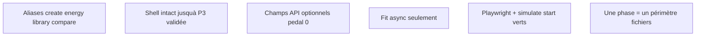

1. Ne jamais casser `/?mode=create`, `/compare`, ni `POST /api/simulate/start`.
2. Pas de big-bang sur `CycleGenShell`.
3. Pas de fit HTTP synchrone long.
4. Pas de métier (interp/smooth/Markov) dans React.
5. Scripts batch conservés jusqu’à couverture tests services.

---

## 10. Phases de livraison (ordre strict — post-Gemini)

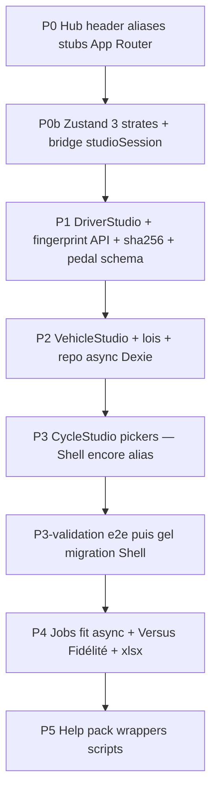

| Phase | Risque | Notes |
|-------|--------|-------|
| P0 | Faible | Stubs ; **pas** toucher logique Shell |
| P0b | Moyen | Store avant d’éclater l’état |
| P1 | Moyen | Fingerprint + hash |
| P2 | Faible | Banques async |
| P3 | Moyen | Cycle unifié ; Shell toujours sur create |
| P3-validation | Gate | e2e verts avant extraction Shell |
| P4 | Élevé | Job runner fit |
| P5 | Faible | Polish |

---

## 11. Fichiers pivots (où regarder en premier)

### Frontend
- `frontend/src/components/CycleGenShell.tsx` — **ne pas découper avant P3-validation**
- `frontend/src/components/Sidebar.tsx`, `SimParamsPanel.tsx`, `VehiclePanel.tsx`
- `frontend/src/components/StudioHome.tsx`, `compare/CompareStudio.tsx`
- `frontend/src/lib/studioSession.ts` → bridge Zustand
- `frontend/src/lib/driverIdentify.ts`, `driverLibrary.ts`, `cycleLibrary.ts`, `vehicleLibrary.ts`, `api.ts`

### Backend
- `backend/app/main.py`, `models/schemas.py`
- `backend/app/services/kinematic_solver.py`, `simulation_manager.py`
- `backend/app/api/routes_simulate.py` — **modèle async à imiter** pour calibrate jobs

### Scripts / data RS
- `scripts/batch_xspace_avl_compare.py`, `batch_route_studio_here_replay.py`, `_refit_route_studio_pedal.py`
- `…/route_studio_here/` compare JSON + HTML
- `frontend/public/data/route_studio_fit_pack.json`

---

## 12. Ce qu’un agent NE doit PAS faire

- Refactoriser `CycleGenShell` en une passe / avant P3-validation.
- Fit calibrate **synchrone** long sur le thread FastAPI.
- Muter le corridor in-place entre studios ; passer corridor via URL.
- Interpolation / smoothing / clamp grade / Markov dans l’UI.
- CRUD localStorage sans couche async.
- Réécrire Next / charte MarketChain / enum PreA cassant.
- Remplacer Versus produit par le HTML Plotly (rapport seulement).
- Modifier des fichiers hors phase en cours.
- Committer secrets `.env` / clés HERE.
- « Bullshit UI » décorative hors données.

---

## 13. Glossaire IDs pack Route Studio

| id | Rôle |
|----|------|
| `route-studio-prudent` | Conducteur agrégé RS prudent |
| `route-studio-dynamique` | Conducteur agrégé RS dynamique |
| `xspace-prea-grossglockner` | Conducteur + référence PreA Glock |
| `rs_fit_{route}_{style}` | Cycle CycleGen geometry-lock dans le pack |
| Routes | `iseran`, `veleta`, `stelvio`, `grossglockner` |
| Styles | `prudent`, `dynamique`, `prea` |

---

## 14. Résumé exécutif (post-Gemini)

1. Lire ce brief + [`refonte-master-rules.md`](refonte-master-rules.md) + règle Cursor.  
2. **P0** stubs — Shell intouché.  
3. **P0b** Zustand ledger 3 strates.  
4. **P1** fingerprint API + SHA-256 + pedal defaults 0.  
5. **P2–P3** banques async + CycleStudio ; gate e2e.  
6. **P4** jobs fit async seulement.  
7. Jamais de métier scientifique dans React.

Fin du brief.
